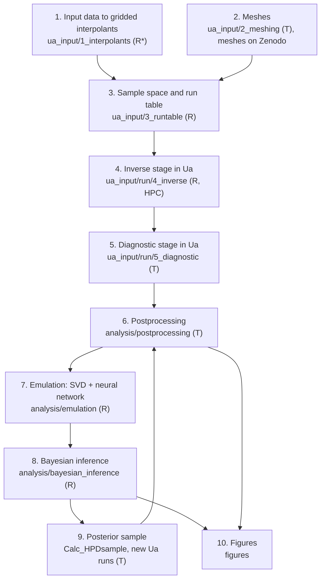

# Workflow overview

This repository contains the code behind the calibration of an ensemble of ice-flow models (Ua) against observed
changes in ice speed, for two domains: the Amundsen Sea sector of West Antarctica (`AMUND`) and a synthetic
Pine-Island-like glacier (`SYNTH_PIG`). The workflow has four stages:

1. an **ensemble of inversions**, in which each member has its own sliding / rheology parameters and is constrained by observed velocities and dh/dt;
2. **diagnostic (perturbation) experiments**, which apply a change in geometry to every member and record the instantaneous change in ice speed;
3. **emulation**: a neural network is trained to predict the change in speed from the parameters;
4. **Bayesian inference**: the emulators are used in an MCMC calibration against the observed change in speed, giving the posterior distribution of the parameters.

Raw model output (restart and result files) is not part of the repository but can be obtained upon request from the author. Scripts are marked as one of:

* **R**: runnable with the input data listed (public datasets have to be downloaded from their original sources; other data that is not in the repository can be obtained upon request from the author);
* **T**: *for transparency, not runnable*: shown so that the method can be inspected, it needs raw model output or other data that can be obtained upon request from the author.

## Steps

| # | Step | Scripts | Main inputs | Main outputs | Status |
|---|---|---|---|---|---|
| 1 | (SYNTH_PIG only: the synthetic glacier and its spinup and transient experiments are in the Ua user files of `ua_input/0_synth_pig`.) Gridded interpolants of reference geometry, velocities and thickness changes, and their extrusion into data gaps | `ua_input/1_interpolants/` (`Create_BMv3_B2_Bam2009_RAMP2_RefGeomGriddedInterpolants`, `Create_MeaSUREs_ITSLIVE_*_VelocityGriddedInterpolants`, `Calc_ITSLIVE_CPOM_Paolo2023_Deltas`, `Calc_dh_from_ds`, `Create_Geometry_from_reference_and_ds`, `Create_ExtrudedFields_GriddedInterpolants`, `ExtrudeField`) | BedMachine v3, MEaSUREs / ITS_LIVE velocities, surface elevation change data (public datasets, to be downloaded from the original sources); reader functions that you provide (see below) | `GLUE_Data/GLUE_Interpolants/*.mat` | R* (needs your own data readers) |
| 2 | Ua meshes: the AMUND meshes for 2000, 2009, 2014 and 2020, cut out of a refined Antarctic mesh; the SYNTH_PIG mesh is made offline | `ua_input/2_meshing/` | refined Antarctic mesh (can be obtained upon request from the author) | mesh, boundary and fixed-boundary files in `GLUE_Data/GLUE_MeshData` | T (the meshes themselves are archived on Zenodo, DOI: see README) |
| 3 | Sample space and run table of the inverse ensemble: Sobol sample (300 members, `rng(1)`) of log10 of the regularisation parameters (gsA, gsC, gaA, gaC), the exponents m and n, and the dhdt error cap | `ua_input/3_runtable/` (`GenerateSampleSpace_Inverse`, `GenerateRunTable_Inverse`; they use `ReadWritetable` in `ua_input/run/`) | none | `RunTable_*.csv` | R |
| 4 | Inverse stage in Ua. Each member runs the cycle: inversion with velocities only, a short spin-up, inversion with velocities and dh/dt | `ua_input/run/` (general scripts for the inverse and the diagnostic stage: `UaWrapper`, `UaJob`, `CleanUp`, `ReadWritetable`), `ua_input/run/ua_core_overrides/` (modified copies of Ua core functions used in the runs), `ua_input/run/4_inverse/` (Ua user input files of the inverse stage) | run table, interpolants, meshes, Ua | Ua results and restart files per member | R (needs Ua and an HPC system; restart files can be obtained upon request from the author) |
| 5 | Diagnostic stage: for each finished inversion, a velocity solve with the original geometry and with new geometry (new calving front and/or ice thickness of a later year), with the inverted A and C fixed | `ua_input/run/5_diagnostic/` | restart files of step 4 | Ua results per experiment | T |
| 6 | Postprocessing: maps of the change in speed per member (`DiagnosticData/<domain>/<domain>_Delta_u_*.mat`), inversion parameters per member, and fluxes across the grounding line and open boundary per basin for the posterior sample | `analysis/postprocessing/` (`Calc_PerturbationResults_Ensemble`, `Calc_UaGLFlux_PerBasin`, `Calc_UaOBFlux_PerBasin`, `FluxAcrossBoundary`, `RemoveIceRisesAndIslands`, and `Calc_InverseResults_Ensemble`, which collects the inversion results into `InversionData/`; `plot_PerturbationResults_Ensemble` writes the `Delta_u` files from them; `plot_InverseResults_Ensemble` plots the inversion ensemble) | results of steps 4 and 5 | `DiagnosticData/`, `InversionData/` | T for the collection scripts (the processed data are in the data archive, DOI: see README); `plot_PerturbationResults_Ensemble` can be run from the processed data |
| 7 | Emulation: `Calc_SVD_basis` assembles predictors and targets and the singular value decomposition; `prepare_data_for_Delta_u_emulators` reduces the maps to the leading components and writes normalised training data; `RNN_network_optimisation_JDR.py` trains the residual neural network (hyperparameter search with keras-tuner); `plot_Emulator_MSE` evaluates the emulator on the test data (Figure A3) and writes the emulator errors `MSE_RNN_*.mat` used in step 8 | `analysis/emulation/` | `DiagnosticData/<domain>/*Delta_u*.mat`, extruded velocity interpolants | `Emulators/<domain>/SVD_files`, `.../RNN/mat_files`, `.../RNN/TF_files` (TensorFlow models) | R (MATLAB, then Python in a TensorFlow 2.13 environment, versions in the header of `RNN_network_optimisation_JDR.py`) |
| 8 | Bayesian inference: MCMC (UQLab, affine-invariant ensemble sampler) with a likelihood that combines measurement, model and emulator errors in the SVD basis; `Calc_MarginalsInference` then fits marginals and a copula to the posterior sample | `analysis/bayesian_inference/` (`Driver_BayesianInference`, `Calc_BayesianInference`, `loadvelocitydata`, `Calc_MarginalsInference`; `plot_Inverse_ParameterDistribution` shows the parameter ranges of the inversion ensemble and `Calc_SemiVariogram` the range of the spatial correlation of the speeds) | emulators of step 7, `DiagnosticData`, extruded velocity interpolants, UQLab | `BayesianAnalysis/<domain>/*.mat` (`myBayesianAnalysis`, `myPosteriorDist`) | R |
| 9 | Posterior sample: `Calc_HPDsample` draws parameter sets from the high-density region of the posterior (the highest-density samples that hold 95% of the density-weighted mass); these are run through steps 4 to 6 again (run table `HPDSample`: [TODO: script]) | `analysis/bayesian_inference/Calc_HPDsample` | `myPosteriorDist` | sample of parameters; results of the new Ua runs | sampling R, Ua runs T |
| 10 | Figures of the paper | `figures/` (see `figures/README_figures.md`) | `BayesianAnalysis`, `DiagnosticData`, `Emulators` and, for Figures 2 and 5, raw model output | `Figure*.png` | R, except Figures 2 and 5 (T) |

## Where the pieces fit together

* **Parameters**: the predictors of the emulators and the likelihood are `[sliding law] log10(gaA) log10(gaC) log10(gsA) log10(gsC) m n [log10(dhdt_err)]`.
  The sliding law is a continuous variable in [1 2] in the inference, rounded to 1 (Weertman) or 2 (Umbi).
* **Perturbations**: `Original`, `Calv` (new calving front), `dhIS` (new ice shelf thickness), `dh` (new ice shelf and
  grounded ice thickness) and `Calv_dh` (all three). In the diagnostic run table these are called `Original`, `Calv`,
  `ISthick`, `thick` and `Calv_thick`. The AMUND calibration uses `Calv_dh` and the SYNTH_PIG calibration uses `dh`.
* **Epochs**: AMUND: start 2000, targets 2009, 2014 and 2020 (the three emulators are combined in the likelihood).
  SYNTH_PIG: start Weertmanyr30, targets Weertmanyr35 to Weertmanyr75.
* **Working folders** expected by the analysis scripts (relative to the folder in which they are run):
  `GLUE_Data/{GLUE_MeshData,GLUE_Interpolants,GLUE_HelperFunctions}`, `DiagnosticData/<domain>`, `InversionData/<domain>`,
  `Emulators/<domain>/{SVD_files,RNN/mat_files,RNN/TF_files}`, `BayesianAnalysis/<domain>`, `Figures`.

## Requirements

* **MATLAB path**: the scripts do not change the MATLAB path (except for the placeholder `addpath("/path/to/ua/source/folder")`
  in `ua_input/run/UaWrapper.m`, which you have to adapt); add this repository (with subfolders), Ua, UQLab, the
  third-party and helper functions and the reader functions to the path before running them.

* **Ua** (https://github.com/GHilmarG/UaSource) for steps 4 and 5 and for the plotting functions; no specific version is tracked.
* **MATLAB** with the Mapping, Image Processing, Statistics and Machine Learning, Optimization and Parallel Computing toolboxes, and,
  for steps 7 to 10, the Deep Learning Toolbox with the Deep Learning Toolbox Converter for TensorFlow Models.
* **UQLab** Rel. 2.0.0 (third party, https://www.uqlab.com) for steps 8 and 9 and the figures.
* **Python** environment with TensorFlow 2.13 (Keras 2), keras-tuner, numpy and scipy for the emulator training
  (the saved models are imported in MATLAB, which cannot import Keras 3 models).
* Third-party MATLAB functions: [TODO: exact names and versions of the helper toolboxes (`demresize`, `gridbin`, `filt2`,
  `geoimread`, `inpaint_nans`, `cmocean`, `fig`, ...)].
* **Reader functions** for the proprietary or binary data (`measures_annual`, `itslive_annual`, `measures_amundsen`,
  `bedmap2_interp`, `read_Bamber_2004`) are not included; step 1 needs them. [TODO: expected interfaces].

## What can be reproduced from the data in the repository

With the processed data (`DiagnosticData`, `InversionData`, `BayesianAnalysis`, `Emulators`: DOI: see README) steps 7 to 10 can be
repeated and all figures except Figures 2 and 5 can be made. Steps 1 and 3 to 6 are provided so that the method can be
inspected and re-run with the data (public datasets from their original sources; other data can be obtained upon request from the author) and an Ua installation.

## Use of AI

This document and the cleaning and documentation of the scripts were prepared with the help of an AI model (Claude, Anthropic); see the
section "Use of AI" in the top-level `README.md`.

## Attribution

`analysis/emulation/RNN_network_optimisation_JDR.py` is adapted from the training script of Rosier et al. (2025),
The Cryosphere 19, 2527, https://tc.copernicus.org/articles/19/2527/2025/ [TODO: licence of the original].
